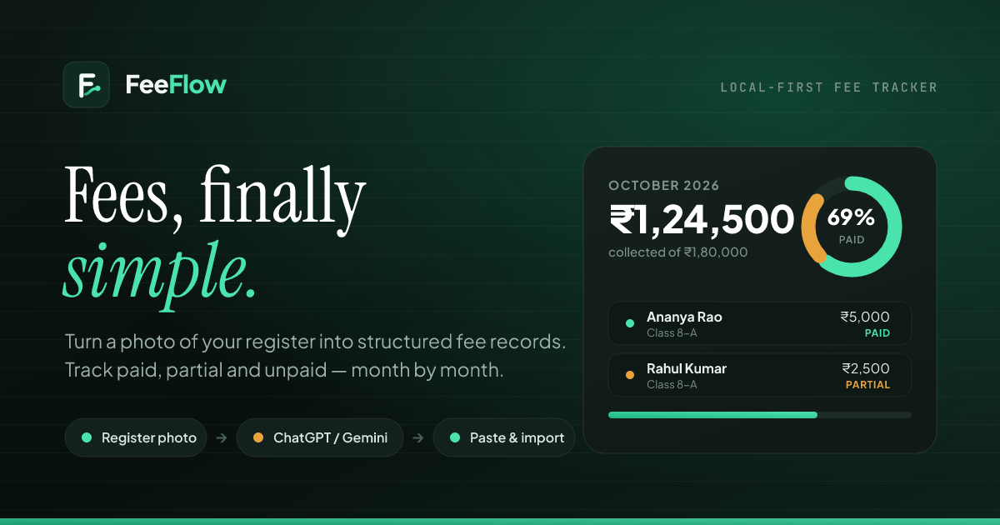

<p align="center">
  
</p>

<h1 align="center">FeeFlow</h1>

<p align="center"><em>Fees, finally simple.</em></p>

<p align="center">
  Turn a photo of your fee register into structured student fee records.<br>
  <strong>Register image → ChatGPT / Gemini → JSON → paste → import → track.</strong>
</p>

<p align="center">
  
</p>

FeeFlow is a **local-first, mobile-first SaaS-grade web app** for schools, tutors, coaching centres and teachers who still track fees on paper. There is no backend, no account and no upload: every student, payment and month lives in your browser's `localStorage` and the whole app keeps working offline.

---

## The workflow it is built around

1. **Photograph** the fee register page.
2. **Upload** the photo to ChatGPT or Gemini with FeeFlow's ready-made prompt (one tap to copy).
3. **Copy** the JSON the AI returns.
4. **Paste** it into FeeFlow's big typing box — or drop in a `.json` file.
5. **Import.** FeeFlow validates, normalises, de-duplicates and builds the records.
6. **Track** paid / partial / unpaid students month by month, with a live dashboard and donut chart.

Non-technical users never touch anything scarier than a paste box.

## Features

- **Dashboard** — students, total fees, collected, pending, collection rate, month-over-month bars, needs-attention list and a live activity feed.
- **Payment states** — every student is exactly `paid`, `partial` or `unpaid`, always derived from the numbers (`paid ≥ fee → paid`, `0 < paid < fee → partial`, `paid = 0 → unpaid`).
- **Students** — add, edit, delete (with undo), quick “collect payment”, search by name / class / roll, class filter chips, status tabs, sorting, pagination for thousands of rows. Cards on phones, a real table on desktop.
- **Import** — paste-first textarea with *live* validation (“✓ JSON is valid · ✓ 24 students detected · ✓ ready to import”), file upload that reads + validates + imports automatically (re-selecting the same file still works), drag & drop as a bonus, and a scrollable preview before anything is written.
- **Forgiving JSON** — `{students:[…]}`, `{data:[…]}` or a bare array; field aliases (`student_name`, `className`, `section`, `total_fee`, `amount_paid`, `payment_status`, …); money like `₹5,000`, `2,500.00`, `Rs 500`, `—`; class + section combined; negatives clamped; over-payments capped; missing paid treated as 0.
- **De-duplication** — matches on *name + class* with three modes: update existing, skip duplicates, or replace the month.
- **Months** — every month is its own ledger with its own students, stats and chart. Create new months empty or carried over (optionally rolling unpaid balances into the new fee). Previous months are never overwritten.
- **Charts** — hand-rolled animated SVG donut (no chart library) plus a billed-vs-collected trend.
- **Backups** — export/restore a full JSON backup, export any month as CSV, print a clean one-page fee report.
- **PWA** — installable to the home screen, offline-capable via a service worker.
- **Premium UI** — dark “Ink” and light “Paper” themes, editorial serif display type, tabular mono numerals, bottom navigation with a centre FAB on phones, keyboard shortcuts on desktop, toasts with undo, reduced-motion support.

## Run it

No build step, no dependencies — it is a static site.

```bash
# any static server works, e.g.
python3 -m http.server 4173 --bind 0.0.0.0
# or
npx serve .
```

Then open `http://localhost:4173`. Double-clicking `index.html` also works for a quick look (install/PWA features need a served origin).

### Host it on GitHub Pages

1. Push this repository (it is already everything the site needs).
2. **Settings → Pages → Source: GitHub Actions.**
3. The included workflow (`.github/workflows/deploy.yml`) publishes the site on every push to `main`.

Full instructions, plus Netlify / Vercel / any-nginx alternatives, live in **[docs/HOSTING.md](docs/HOSTING.md)**.

## Project layout

```
index.html            app shell (sidebar, topbar, bottom nav, view outlet)
sw.js                 service worker (offline shell)
manifest.webmanifest  PWA manifest
404.html              branded not-found page
css/                  fonts · tokens · base · layout · components · views · print
js/core/              util · money · importer · store (localStorage) · router
js/ui/                icons · toast · modal/sheets · charts · components · list
js/views/             dashboard · students · import · months · settings
assets/fonts/         self-hosted woff2 subsets (latin + latin-ext for ₹)
assets/icons/         generated PNGs + the SVG sources they come from
tools/build-icons.mjs regenerates icons & the social image from SVG (dev only)
tests/                node:test unit tests + a jsdom smoke test of the real UI
```

## Development

```bash
npm install     # dev-only tooling: jsdom for tests, resvg/fonts for asset builds
npm test        # 15 unit tests + 13 end-to-end jsdom tests of the real UI
npm run build:assets   # rebuild icons/og-image from assets/icons/src/*.svg
```

The published site loads **zero** runtime dependencies: no framework, no chart library, no CDN fonts.

## Privacy

FeeFlow never sends student data anywhere. Storage is `localStorage` under the key `feeflow_v1`; it is written after every add, edit, delete, payment, import and month change, and flushed on tab hide/close. Exporting or restoring a backup is always the user's explicit action.

## License

MIT — see [LICENSE](LICENSE).
